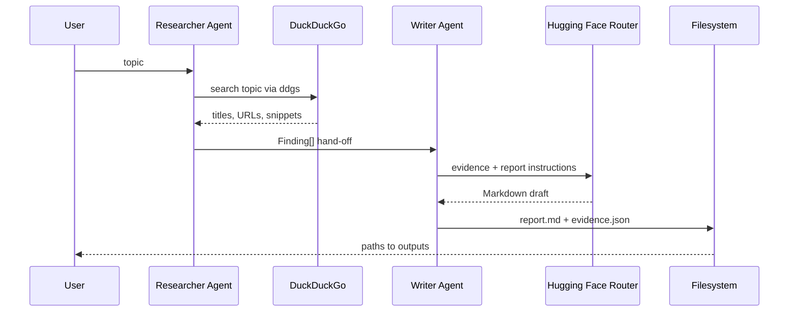

# Day 9 Architecture

## Agent boundary

The Researcher and Writer are separate Python classes with separate responsibilities. The Researcher never writes the final report. The Writer never performs web search; it can use only the findings passed to it. This explicit hand-off makes the system easier to test and reduces accidental unsupported claims.

## Source grounding

Each `Finding` contains a title, URL, snippet, and source label. The Writer prompt requires citations and prohibits facts outside the supplied evidence. The evidence JSON is saved beside the report so a reviewer can inspect exactly what the Writer received.

## Provider boundary

The Writer uses the Hugging Face OpenAI-compatible Router endpoint with `HF_TOKEN`. The default model route is `Qwen/Qwen2.5-Coder-32B-Instruct:featherless-ai`. If inference is unavailable, the `--offline-demo` mode still produces a deterministic report from search snippets without hosted-model generation.

## Why not hide the workflow behind CrewAI?

CrewAI is useful for larger crews, tools, memory, and task graphs. This Day 9 portfolio project keeps the orchestration visible so the learner can see the hand-off, prompts, evidence object, and output files. A future extension can wrap `ResearcherAgent` and `WriterAgent` as CrewAI agents without changing the data contract.
